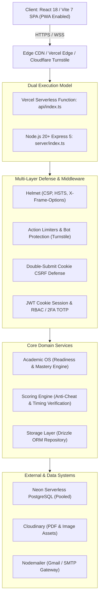
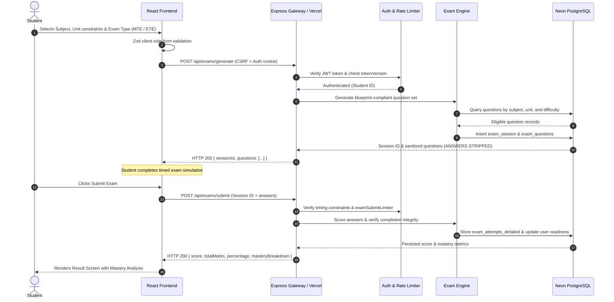

# Padho LPU — Comprehensive Architecture & Dependency Audit (Phase 2)

**Document Version:** 1.0.0  
**Generated At:** 2026-10-28T22:46:00+05:30  
**Auditor:** Principal Software Architect  
**Scope:** Full-stack architecture, entrypoints, routing, ORM, security boundaries, and data lifecycles.

---

## 1. System Topology & High-Level Architecture

Padho LPU is an isomorphic, full-stack educational web application designed for students of Lovely Professional University (LPU). It provides curated course notes, past examination papers, chapter-level practice quizzes, and full 100-mark mock examination simulations adhering to official LPU blueprints.

---

## 2. Frontend Architecture

### 2.1 Entry Points & Bootstrapping
- **HTML Entry:** `client/index.html` — Sets semantic HTML5 structure, theme initialization script (preventing dark mode flash), PWA manifest declaration, responsive viewport tags, canonical domain metadata (`https://padholpu.online/`), and structured JSON-LD schemas.
- **Application Bootstrapper:** `client/src/main.tsx` — Mounts the React root with React 18 Concurrent Mode (`createRoot`), binds TanStack Query `QueryClientProvider`, theme provider (`next-themes`), and renders `App`.

### 2.2 Routing & Route Splitting
- **Router:** `wouter` lightweight client-side router (`client/src/App.tsx`).
- **Code Splitting:** All route components (except `HomePage` for instantaneous First Contentful Paint) are dynamically imported using `React.lazy()`:
  - Public entity pages: `about-page`, `contact-page`, `resources-page`, `resource-detail-page`, `quizzes-page`, `quiz-detail-page`, `subject-page`, `subjects-directory-page`, `semester-page`.
  - Authenticated interactive flows: `quiz-page`, `quiz-review-page`, `exam-generator-page`, `exam-start-page`, `exam-result-page`, `progress-page`, `user-profile-page`, `profile-edit-page`.
  - Administrative workflows: `admin/Login`, `admin/Dashboard`, `AdminSupport`.
  - Legal & Compliance: `privacy-policy`, `terms-of-service`, `cookie-policy`, `disclaimer`, `privacy-requests`.
- **Protected Routing:** Handled by `ProtectedRoute` wrapper in `client/src/App.tsx`.
  - If authentication is pending, displays `PageSkeleton`.
  - If user is unauthenticated, renders `UnauthorizedPage` preserving the intended return destination in query params.
  - If user lacks required roles (RBAC), renders `ForbiddenPage` without leaking system privileges.

### 2.3 State Management & Caching
- **Server State:** Managed through `@tanstack/react-query` v5 (`client/src/lib/queryClient.ts`).
  - Cache Isolation: When a user logs out, `queryClient.clear()` is called unconditionally to purge cached user telemetry, profile details, and test attempts from memory.
- **Client Auth State:** Managed through `AuthProvider` in `client/src/hooks/use-auth.tsx`, persisting user identity via `/api/user` and session cookies.

---

## 3. Backend Architecture & Runtime Modes

The backend employs a dual runtime strategy:

1. **Standalone Production Mode (`server/index.ts`):**
   - Transpiled to CommonJS (`dist/index.cjs`) using esbuild.
   - Listens on configurable `PORT` (default 5000), binds HTTP server, initializes DB bootstrap, registers routes, and serves production static assets from `dist/public`.
2. **Serverless Production Mode (`api/index.ts` & `netlify/functions/api.ts`):**
   - Implemented via `serverless-http` wrapping Express.
   - Performs lazy initialization with idempotent `initPromise` latching so concurrent serverless cold starts do not race database bootstrapping.
   - Normalizes path prefixes across Vercel and Netlify rewrites.

### 3.1 Middleware Pipeline
Every HTTP request traverses an ordered defense-in-depth pipeline:
1. **Canonical Host Normalization:** 301 redirects legacy hosts `studylpu.online` and defensive mirror `padholpu.info` to `https://padholpu.online`.
2. **Security Headers (Helmet):** Enforces strict CSP, HSTS (`max-age=31536000`), `X-Content-Type-Options: nosniff`, and `X-Frame-Options: DENY`.
3. **Payload Inspection & Sizing:** Limits JSON and URL-encoded bodies to 100KB in general (5MB in serverless / upload endpoints) with raw body retention for HMAC verification.
4. **Anti-Automation & Bot Protection:** Cloudflare Turnstile token validation and heuristic IP cluster detection.
5. **Double-Submit CSRF Verification:** Validates `x-xsrf-token` header against the encrypted `XSRF-TOKEN` cookie for state-changing operations (`POST`, `PUT`, `DELETE`).
6. **Authentication & Session Attachment:** Extracts stateless `token` from httpOnly cookies or `Authorization: Bearer`, verifies signature and database `tokenVersion`, and binds `req.user`.
7. **Rate Limiting:** Layered rate limiters:
   - `strictAuthLimiter`: 5 failed attempts per 15 min.
   - `quizSubmitLimiter`: 10 submissions per minute.
   - `examSubmitLimiter`: 5 submissions per 5 minutes.
   - `downloadLimiter`: 20 downloads per 10 minutes.
   - `uploadLimiter`: 5 uploads per hour.

---

## 4. Database Architecture & ORM Design

### 4.1 ORM & Dialect
- **ORM:** Drizzle ORM (`drizzle-orm` v0.45+) utilizing PostgreSQL dialect.
- **Connection Adapter:** Intelligent dual connection pooling in `server/db.ts`:
  - If connection URI points to Neon (`neon.tech` or `neon.`), uses `@neondatabase/serverless` WebSocket pool (`NeonPool`).
  - Otherwise, uses standard `pg.Pool` with SSL verification.

### 4.2 Entities & Schemas
- **User Domain:** `users` (credentials, roles, streak, score, trust levels, TOTP secrets, recovery codes).
- **Academic Hierarchy:** `subjects` -> `units` -> `topics` -> `questions`.
- **Study Materials:** `resources` (categorized by type: Notes, Past Paper, Syllabus; with unit and semester tags).
- **Assessment Engine:** `quizzes`, `quiz_attempts`, `exam_sessions`, `exam_questions`, `exam_attempts_detailed`.
- **Integrity & Auditing:** `score_audit_log`, `action_log`, `admin_logs`, `rate_limits`.
- **Student Engagement:** `leaderboard`, `testimonials` (moderated user reviews), `notifications`.

---

## 5. End-to-End Data Flow Trace

### Flow: Student Mock Exam Generation & Submission

---

## 6. Codebase Quality, Bottlenecks & Anomaly Findings

| Area | Finding | Impact | Status / Remediation |
|---|---|---|---|
| **Build Transpilation** | Warning: `import.meta` used in CommonJS output mode (`server/index.ts:100`) | Minor runtime noise during server bundling | Replace `import.meta` check with CommonJS-safe entrypoint detection (`process.argv[1]` / `require.main`). |
| **Git Configuration** | `.gitignore` line 5 had `api` ignoring `api/index.ts` | Serverless deployment on Vercel would lack function code | Fixed in `.gitignore`. |
| **Test Database Decoupling** | Integration tests (`dynamic-product-integration.ts`, `testimonial-flow.ts`) require live DB connection without fallback | Running `npm test` offline without `DATABASE_URL` halts execution | Add environment check / mock capability for local unit and CI testing. |
| **Vulnerability Audit** | 21 transitive dependency advisories (DOMPurify, multer, fast-uri, body-parser, vite) | Supply-chain security hygiene | Run non-breaking `npm audit fix` and pin safe patch versions. |
| **Zero Paywall Policy** | Prior versions had Gold Coin deductions; modern codebase enforces 100% free open access | Preserved | Verified in adversarial suite points 5, 6, 7. |
